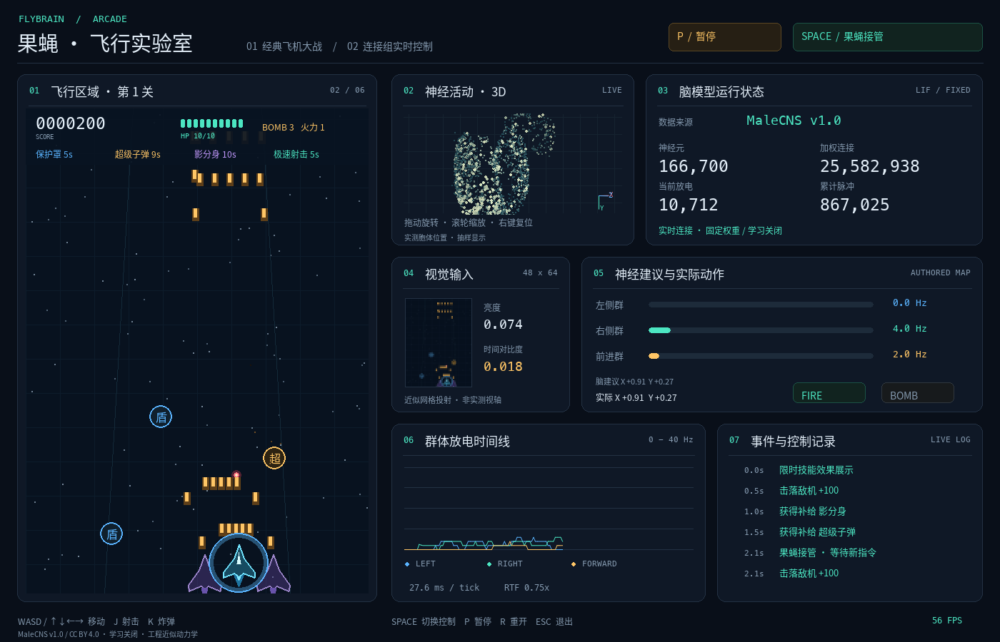

# 果蝇 · 飞行实验室

Python 3 飞机大战与果蝇连接组控制实验。左侧是可独立人工游玩的纵向射击游戏，右侧显示视觉输入、脑活动投影、群体放电、控制输出及事件。支持 Windows、macOS 和 Linux 桌面。



## 开始游玩

需要 Python **3.11 或更新版本**。在项目根目录运行：

```bash
python3 -m venv .venv
```

macOS / Linux：

```bash
.venv/bin/python -m pip install -r requirements.txt
.venv/bin/python main.py
```

Windows：

```powershell
.venv\Scripts\python.exe -m pip install -r requirements.txt
.venv\Scripts\python.exe main.py
```

启动脚本统一放在 `scripts/` 目录：双击 **scripts/run.command**（macOS）或 **scripts/run.bat**（Windows）。Linux 可以在项目根目录执行 `sh scripts/run.command`。脚本会先切换到项目根目录，因此从其他工作目录调用也会使用正确的虚拟环境和脑数据。启动脚本自动建立项目内虚拟环境并安装缺失依赖；字体随项目提供，无需安装系统字体。桌面图形环境是正常游玩的前提。

首次下载项目后，如需使用真实果蝇连接组，请先按下文运行 `python main.py prepare` 准备 `brain_data/`；已有完整数据时可直接执行 `./scripts/run.command`。

| 按键 | 功能 |
|---|---|
| Enter / 点击开始按钮 | 起飞；默认由果蝇控制 |
| **空格** / 点击右上控制按钮 | **人工 ↔ 果蝇操作**，脑始终保持感知和计算 |
| WASD / 方向键 | 人工移动 |
| J / 在游戏区域内按住鼠标左键 | 人工射击 |
| K | 人工释放炸弹，每次按下消耗一枚 |
| P / Pause / 点击顶部暂停按钮 | 暂停 / 继续，游戏和神经仿真同时暂停 |
| 在 3D 脑图中拖动左键 | 旋转视角 |
| 在 3D 脑图中滚动滚轮 / 右键 | 缩放 / 恢复初始视角 |
| R | 重开游戏，保留当前神经状态 |
| Esc / 关闭窗口 | 退出 |

失去窗口焦点会自动暂停，回到窗口后按 P 继续。空格使用按下沿切换，长按不会反复切换。

飞机初始和最大生命均为 **100**。第一关共 **6 架小型敌机**，同时最多 **2 架**，刷新间隔约 2.4～3.2 秒，敌弹初速 90 px/s。清空本波敌机（击落或离场）后过关，清除敌弹并休整 3.5 秒；不会仅因经过一段时间就升级。后续每关增加 2 架敌机，逐步提高刷新速度、敌机上限和敌弹强度；第 3 关开始出现中型敌机，第 5 关开始出现重型敌机。

击落敌机可能掉落补给，接近 125 像素会自动吸附。第一枚掉落为保护罩，前 3 枚掉落依次介绍保护罩、超级子弹和影分身，随后随机混合其他补给。初始每次击落掉落概率约 72%；随关卡降低到约 43%、28%……，计算时也补偿后续波次敌机数量，令**每关预期掉落总数**逐步减少。

| 补给 | 效果 |
|---|---|
| 保护罩 | 8 秒内抵挡敌弹和碰撞伤害 |
| 超级子弹 | 10 秒内五向强化射击，主炮单发伤害提高到 3 |
| 影分身 | 12 秒内出现两架无碰撞分身，随主机移动并协同射击 |
| 极速射击 | 8 秒内缩短射击间隔 |
| 限时血包 | 恢复 10 HP（上限 100），出现 15 秒后消失；每 18 秒主动投放，也可能由敌机掉落；未接住时会继续下落，飞出底部屏幕即消失 |
| 火力 / 炸弹 | 永久火力升级（上限 3）/ 补充炸弹（上限 5） |

血包显示剩余拾取秒数，最后 2 秒闪烁提示；暂停时投放和到期计时冻结。限时技能可同时生效，拾取相同技能刷新持续时间，HUD 显示剩余秒数；暂停时技能计时冻结。人工操作不会执行脑建议，但脑仍观察玩家游玩时的画面并持续更新状态。可以从启动时直接选择人工操作：

```bash
python main.py --manual
```

## 使用真实果蝇连接组

```bash
python main.py prepare
python main.py --brain malecns
```

`prepare` 从 [MaleCNS 官方公开数据](https://male-cns.janelia.org/download/) 下载约 **1.11 GB** 的原始表，然后生成约 **230 MB** 的缓存。准备阶段需要额外内存，建议使用至少 8 GB RAM 的电脑；保留缓存和原始表需约 1.35 GB 磁盘空间。下载支持断点续传，不需要账户或 API token。

### brain_data 下载地址

本项目使用 **MaleCNS v1.0**。以下是 `prepare` 使用的官方原始文件直链；也可以手动下载，按表中名称放入 `brain_data/raw/`，然后运行 `python main.py prepare` 生成缓存。

| 数据 | 官方下载地址 | 本地保存路径 |
|---|---|---|
| 神经元注释 | [body-annotations-male-cns-v1.0-minconf-0.5.feather](https://storage.googleapis.com/flyem-male-cns/v1.0/connectome-data/flat-connectome/body-annotations-male-cns-v1.0-minconf-0.5.feather) | `brain_data/raw/annotations.feather` |
| 神经递质 | [body-neurotransmitters-male-cns-v1.0.feather](https://storage.googleapis.com/flyem-male-cns/v1.0/connectome-data/flat-connectome/body-neurotransmitters-male-cns-v1.0.feather) | `brain_data/raw/transmitters.feather` |
| 连接权重 | [connectome-weights-male-cns-v1.0-minconf-0.5.feather](https://storage.googleapis.com/flyem-male-cns/v1.0/connectome-data/flat-connectome/connectome-weights-male-cns-v1.0-minconf-0.5.feather) | `brain_data/raw/weights.feather` |

`weights.npz`、`nodes.npz` 和 `manifest.json` 由本项目预处理生成，没有单独的官方下载链接。GitHub 仓库不包含 `brain_data/` 中的原始表和缓存权重；克隆仓库后需自行准备。数据许可与署名见 [THIRD_PARTY.md](THIRD_PARTY.md)。

### 数据规模与存放位置

- 使用 **166,700** 个具有非空 `superclass` 注释的细胞，包括 `tbc`。
- 保留端点均属于这些细胞的 **25,582,938** 条加权有向连接。
- 连接权重包含多个突触的数量；**连接数不等于单个突触数**。
- 原始地址、处理条件和 SHA-256 记录在 `brain_data/manifest.json`。
- 数据保存在项目根目录下可见的 `brain_data/` 文件夹，不纳入版本控制。仅需运行时，可以在准备完成后自行移走 `raw/`，保留 `weights.npz`、`nodes.npz` 和 `manifest.json`。

果蝇脑数据目录为项目根目录下的 **`brain_data/`**：

| 路径 | 内容 |
|---|---|
| `brain_data/raw/` | 下载的官方原始数据表 |
| `brain_data/weights.npz` | 预处理后的脑连接权重矩阵 |
| `brain_data/nodes.npz` | 神经元、输入输出群体和位置数据 |
| `brain_data/manifest.json` | 数据来源、规模、处理规则和文件校验值 |

运行这些数据的神经仿真代码在 `flybrain/brain.py`，数据准备代码在 `flybrain/data.py`。

默认 `--brain auto` 优先读取真实缓存；没有缓存时使用 **4,096 节点的合成演示网络**。演示模式会在数据来源、位置图说明和窗口底部持续标注。`--brain malecns` 不允许回退到演示网络，缺少缓存时直接提示准备数据。

```bash
python main.py --brain demo
python main.py --brain-data /path/to/brain_data --brain malecns
```

## 脑如何接管

```text
游戏渲染（不含 HUD 和仪表盘）
        ↓ 48 × 64 RGB
6,006 个感光细胞的近似网格投射
        ↓
MaleCNS 全连接图 + 简化 LIF 动力学
        ↓ 下行神经元群体活动
人工定义的动作解码
        ↓
移动 / 射击 / 炸弹 → 游戏
```

模型接收游戏区域的 RGB 像素，以及击杀/实际受伤产生的奖励和惩罚刺激，不读取敌机坐标、玩家血量或目标路径。感光投射、递质符号、动力学参数和游戏动作含义是工程假设。**没有恢复真实果蝇的全部生理机制，也没有训练出游戏策略。**

第一版采用固定权重，**在线学习关闭**，界面持续显示该状态。每击杀一架敌机（含炸弹击杀）向 PAM 注释群体注入奖励电流，每次实际扣血向 PPL1 注释群体注入惩罚电流；护盾、无敌期间拦截的攻击不触发惩罚。人工驾驶时刺激同样生效。这是人工定义的刺激映射，通过膜电位和连接传播影响脑活动，不直接指定飞机动作，也不修改连接权重。脉冲持续 0.5 秒神经时间，重复事件最多累积至 1 秒；面板显示两路刺激剩余时间及累计次数，JSONL 记录触发与消费后的状态。果蝇操作模式下的动作来自神经群体输出，不包含敌机寻路或躲弹规则；人工操作模式下只执行人的输入。持续观察不等于模仿学习。人工定义的解码参数见 [模型说明](docs/brain-model.md)。

神经仿真在独立线程运行，目标 40 Hz；游戏目标 60 FPS。计算不足时，RTF 会如实下降，不会删除连接来伪装实时。**切到人工时，感觉输入和脑状态继续更新，只屏蔽脑对游戏的操作。**切回果蝇操作时，等待切换后开始计算的新结果，避免执行人工模式中积压的建议。超过 300 ms 的输入或输出失效，脑操作归零。暂停、失焦和游戏结束才暂停神经仿真。

状态面板的 **3D 点云**是实际神经活动的抽样：真实数据模式使用实测胞体或 to-soma 的 XYZ 位置，经相机旋转、透视投影和深度排序绘制；缺失位置的神经元仍参与仿真。左键拖动旋转，滚轮缩放，右键复位；旋转脑图不会触发游戏射击。演示模式使用明确标注的示意位置。面板分别显示脑建议与实际操作，人工接管时脑图和放电时间线继续更新。

## 验证与运行记录

```bash
python -m pip install -e '.[dev]'
python -m pytest -q
python main.py validate --brain malecns
python main.py --brain malecns --headless --start --frames 360 --screenshot artifacts/preview.png
```

测试覆盖：游戏碰撞、无敌时间、波次上限与过关、难度/掉落曲线、临时技能及到期、炸弹、可复现随机种子、输入归一化、视觉对运动输出的影响、旧指令丢弃、超时释放、人工操作持续感知、3D 拖动/缩放、暂停和失焦。`validate` 比较相同随机种子下的暗画面、左侧红色刺激和暗画面重放，将结果保存到 `artifacts/validation.json`。它检验感觉输入是否影响控制，不代表生物学有效性或游戏能力。

正常运行将每 100 ms 的运行摘要、控制权、实际动作、分数、血量和事件写到 `runs/*.jsonl`。控制事件附有按键前缀，例如 `W 前进`、`W+D+J 前进 / 右移 / 射击`、`P 暂停`、`SPACE 人工接管`；持续按住同一组合不会逐帧刷屏。果蝇操作也使用同一套动作标识。这份日志用于排查与观察，**不是完整的逐帧回放文件**。使用 `--no-log` 关闭记录。

## 代码结构

| 文件 | 职责 |
|---|---|
| `flybrain/game.py` | 不依赖图形窗口的游戏逻辑 |
| `flybrain/data.py` | 官方数据下载、筛选、构图与缓存 |
| `flybrain/brain.py` | 神经动力学、动作解码与后台线程 |
| `flybrain/app.py` | 控制权切换、游戏循环与日志 |
| `flybrain/ui.py` | 游戏与状态面板渲染 |
| `flybrain/camera.py` | 3D 旋转、透视和缩放相机 |
| `flybrain/validate.py` | 可重复的视觉干预验证 |

参考资料与字体、数据署名见 [THIRD_PARTY.md](THIRD_PARTY.md)。目前已在 macOS 环境验证；Windows 与 Linux 使用同一套跨平台依赖和路径处理，尚未在这两个系统实机验证。
